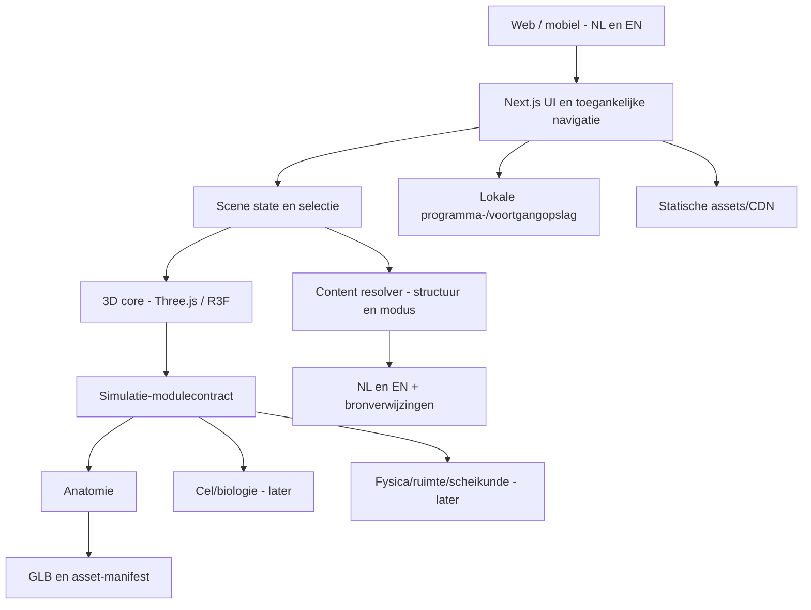

# 01 — Masterplan: product en technische architectuur

## 1. Productvisie

Een "Google Maps van het menselijk lichaam" die uitbreidt naar een interactief 3D-kennisplatform. Centraal staan een stabiele 3D-viewer, verklaarbare educatieve inhoud, en een wisselbaar stelsel van simulatiemodules. Anatomie is de eerste verticale module en stelt kwaliteitseisen aan elk latere vakgebied.

**Beoogde gebruikerservaring:** bezoeker opent de atlas → draait of zoomt het lichaam → kiest een regio/structuur → ziet de juiste anatomische lagen → wisselt tussen Herstellen, Trainen, Leren, Blessures en Sporten → bekijkt feitelijk gecontroleerde informatie, bewegingsanimatie of een optioneel algemeen achtwekenprogramma. De selectie blijft behouden bij modewissel. Er zijn geen vragenlijsten en er is geen AI-chat.

**Productprincipes:** eigen interface, eigen domein; open assetstandaarden; geen vendor lock-in; responsive en toegankelijk; alle educatieve claims traceerbaar; privacy by default; zakelijke/licentie-integriteit vóór monetisatie.

## 2. Afbakening

### V1 — noodzakelijk
- Eén centraal lichaam, één onafhankelijk 3D-canvas en vijf modi als verschillende informatieweergaven van **dezelfde anatomische selectie**.
- Camera: draaien, pannen, zoomen, focussen, reset. Selectie van een object via pointer/touch, plus toetsenbord/toegankelijke structuurboom.
- Toon/verberg systeemlagen; selecteer of isoleer structuur; terug naar regio/lichaam.
- NL/EN-titels en content. Canonieke interne ID's zijn taalneutraal.
- Medisch en wetenschappelijk nagekeken educatieve informatie; geen diagnose.
- In beginsel geen account en geen externe opslag van persoonlijke voortgang. Progressie van gekozen achtwekenprogramma wordt lokaal opgeslagen.
- Preview-omgeving, automatische tests, licentieregister en monitoring zonder gevoelige eventdata.

### V1.1 — na de eerste stabiele demonstratie
- Exploded view, doorsnede/clipping, anatomische relaties en geanimeerde bewegingen.
- 30-secondenuitlegvideo's, met ondertiteling en controle van medische claims.
- Uitgebreider anatomisch bronmodel nadat compleetheid, prestaties en rechten zijn beoordeeld.
- Eerst een enkele algemene trainings-/bewegingsroute van acht weken, geen op symptomen gepersonaliseerde behandeling.

### V2 — uitbreidingen, uitsluitend via plug-incontract
- Cel/microscopisch niveau (eigen scène; educatieve illustratie, geen fysieke continuïteit van het bronmodel).
- Zonnestelsel / natuurkunde / scheikunde / techniek (per onderwerp gevalideerd model én eigen numerieke regels).
- Toegankelijke simulatie-instellingen en kennisvragen zonder persoonlijke vragenlijsten.
- Eventuele synchronisatie en betaling zijn gescheiden werkstromen met een aparte privacy-/juridische beoordeling.

## 3. Voorgestelde stack

| Laag | Voorkeur | Reden / kanttekening |
|---|---|---|
| Frontend | TypeScript, React, Next.js App Router | UI, meertalige routes, SEO voor documentatie, server-rendered inhoud |
| 3D-renderer | Three.js + React Three Fiber + Drei | herbruikbare viewer en scenegraph; WebGL2 als eerst ondersteunde basis |
| 3D-formaat | glTF 2.0 / GLB | industriestandaard, browsergeschikt, compressie mogelijk |
| Eerste testdata | Open Anatomy 3D **modelpakket** | 147 structuur-ID's, gecomprimeerde man/vrouwmodellen, MIT-code / CC BY 4.0-modellen |
| Alternatieve uitgebreide atlas | Anatomy Atlas 3D als **referentie/optie**, niet automatisch geïntegreerd | veel meer structuren, prototype, assets aparte CC BY-SA-herkomst |
| Assetverwerking | Blender, glTF Transform, Meshopt/Draco, KTX2 waar relevant | reproduceerbare conversie, LOD, performance |
| Content | gestructureerde MDX/JSON-content met reviewmetadata | NL/EN, zoekbaar, één waarheid per structuur |
| Simulatielaag | aparte TypeScript-module + Web Worker wanneer nodig | performance-isolatie en wetenschappelijke testbaarheid |
| Voortgang (v1) | IndexedDB of lokale browseropslag | geen account, geen backendopslag van symptomen; enkel programma en voortgang |
| Eventuele backend (later) | Next API routes + Supabase/Postgres | alleen indien synchronisatie aantoonbaar nodig is en privacybeleid is goedgekeurd |
| Hosting/CI | Vercel + GitHub Actions | preview per pull request, versiebeheer, tests en releasecontrole |
| Observability | privacyarme foutregistratie, geen medische gebruiksevents | problemen kunnen opsporen zonder vertrouwelijke inhoud te verzamelen |

**Compatibiliteitsvalkuil:** de kant-en-klare `open-anatomy-3d-react` viewer is volgens README getest met **React 18 + R3F 8 + Drei 9**. De uiteindelijke Next/React/R3F-matrix mag niet zomaar als compatibel worden aangenomen. Daarom gebruiken we eerst het losstaande GLB-/cataloguspakket in onze eigen viewer, óf voeren we een afzonderlijke compatibiliteitstest uit voordat we de viewerwrapper overnemen. Versies worden na de spike vastgepind via een lockfile.

## 4. Logische systeemopbouw



### Monorepo-indeling (voorstel)

```text
apps/web/                     # Next.js UI, routes, SSR-inhoud
packages/ui/                  # design tokens, toegankelijke componenten
packages/core-3d/             # canvas, camera, selectie, layers, controls
packages/sim-sdk/             # interface, registraties, eventtypen
packages/anatomy/             # 3D-adapter, structuurkoppeling, anatomische logica
packages/content/             # NL/EN, bronvermeldingen, content-lifecycle
packages/programs/            # algemeen achtwekenprogramma, lokale progressie
packages/asset-pipeline/      # conversie, metadata, controle
modules/cell/                 # later: eigen microscopische scene
modules/solar/                # later: hemelmechanica
modules/physics/              # later: simulaties met expliciete parameters
assets/manifests/             # assets, licenties, checksums en attributie
tests/unit/ tests/e2e/ tests/visual/ tests/scientific/
docs/adr/ docs/api/ docs/reviews/
```

## 5. Unieke gebruikersnavigatie

- De **huidige anatomische selectie** (`structureId`) en **huidige modus** (`mode`) zijn onafhankelijke statevariabelen; nooit vijf kopieën van de atlas.
- Routevoorbeeld: `/nl/anatomie/lichaam/schouder/deltoideus?modus=leren`.
- Een diepe link bevat alleen publieke selectie/beeldinstellingen; geen symptomen, gezondheidsvragen of programma-voortgang.
- De gebruiker kan even goed beginnen via "3D lichaam" of via een van de vijf modi; alles eindigt in dezelfde selectie- en contentresolver.
- Terugknoppen volgen een hiërarchisch pad; URL en scene-state blijven synchroniseerbaar.
- Bij niet-ondersteunde structuur: transparant tonen "nog geen informatie"; nooit stilzwijgend vervangende anatomie tonen.

## 6. Educatief en medisch kader

- Feitelijke, niet-gepersonaliseerde educatie; geen diagnose of door gezondheidsvragen gestuurde behandelplannen.
- Alle educatieve items hebben auteur/reviewer, status, revisiedatum, bronlink, inhoudsversie en vakgebied.
- Een erkende anatomie-/zorginhoudelijke reviewer beoordeelt claims over anatomie, herstel, belasting en blessures vóór publicatie.
- Korte animatievideo's van ca. 30 seconden worden **vooraf gegenereerd en gecontroleerd** en zijn niet on-the-fly AI-advies.
- Bewegingsanimaties mogen visualiseren welke structuren bewegen; ze claimen niet standaard individuele optimale technieken of medische effecten.
- De stap lichaam → spier → vezel → cel → mitochondrium is een **wissel tussen modellen met verschillende schalen**, niet een onrealistische continue geometrische zoom van één bronmodel.

## 7. Technische randvoorwaarden

- Responsive: aanraakbediening + muis/toetsenbord; duidelijke focus; reduced-motion; tekstueel alternatief voor alle essentiële 3D-kennis.
- WCAG 2.2 AA is de kwaliteitsdoelstelling, getoetst op concrete schermen; de canvas heeft een volledige toegankelijke structuurlijst buiten WebGL.
- De viewer laadt pas als nodig; Next.js server-rendering voor inhoud en client-side rendering voor de WebGL-omgeving.
- De browser ondersteunt een fallback met 2D-overzicht en structuur-/contentnavigatie als WebGL niet werkt.
- Per onderwerp een vaste simulatieversie, inputvalidatie, units en herhaalbare tests; we gebruiken geen generieke game-physics-engine als vervanging van natuurkundige nauwkeurigheid.
- Model- en contentupdates worden geversioneerd; referenties naar oude ID's krijgen expliciete migratieregels.

## 8. Buiten scope voor nu

Geen kopie van Astra AI, geen commerciële betaalstroom, geen automatische AI-chat, geen accounts, geen medische vragenlijst, geen patiëntendossiers, geen persoonlijke diagnoses, geen ongetoetste "100% anatomische nauwkeurigheid" claims, geen poging alle wetenschappelijke onderwerpen direct tegelijk te bouwen.

## 9. Eerste beslispunt

Maak een technische spike die aantoont dat één Open Anatomy 3D-model in een eigen viewer laadt, dat een schouderspier per stabiele ID is selecteerbaar, dat NL/EN-content verschijnt en dat de vijf modi de scene kunnen delen. De technische architect, 3D-engineer, anatomie-reviewer, QA en licentiebeheerder ondertekenen de bewijsstukken. Daarna pas volledige productontwikkeling.

## 10. Versterkte producteis: volledige gelijkmatige kwaliteit

De eerste schouderroute blijft een technische proof of concept. Voor de beoogde complete publieke atlas gelden de [uniforme kwaliteits- en afmaakregels](model/QUALITY-CONTRACT.md): ieder onderdeel binnen de expliciete doelcatalogus wordt volledig uitgewerkt en beoordeeld, inclusief hoogwaardig beeld, anatomische identiteit, inhoud, vijf modi × twee talen, toegankelijkheid en performance. Onderdelen die ontbreken of te grof zijn worden gap-/afmaaktaken; de scope kan niet stilzwijgend worden verkleind. De [3D-engineeringblauwdruk](model/MASTER.md) en [machinecontrole](../model-audit/README.md) operationaliseren dit. Dezelfde kwaliteitsregel geldt voor elke later toegevoegde vakmodule.
