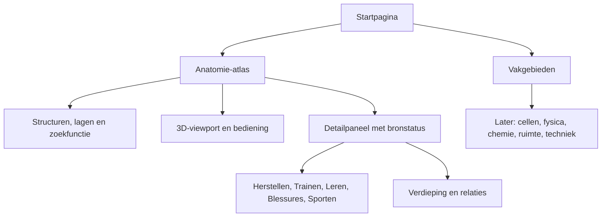
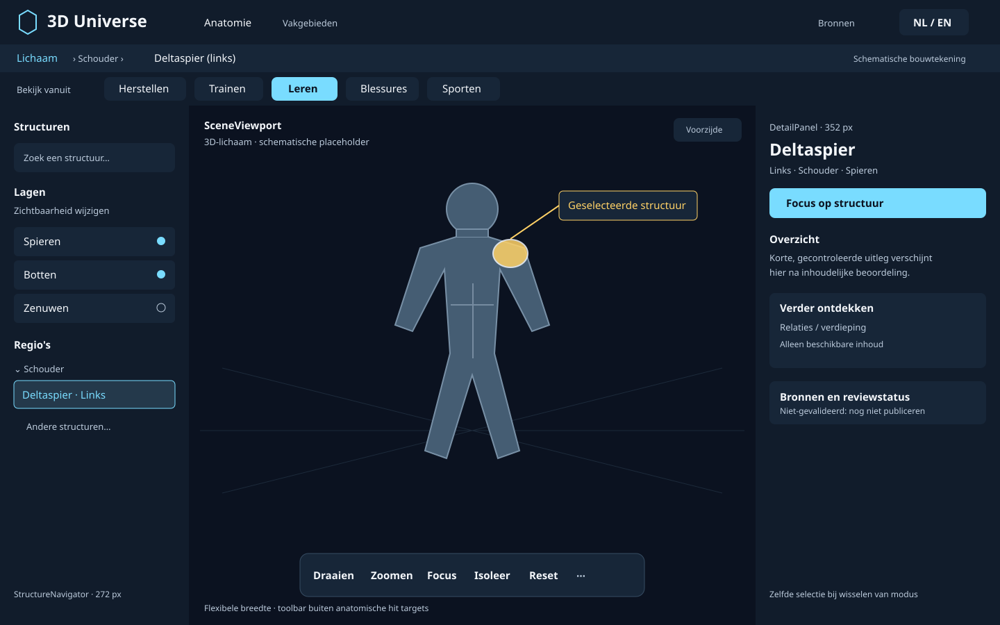
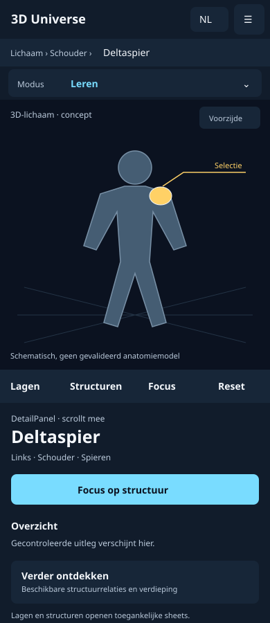

# UX-00 — Geïntegreerde product- en interfaceblauwdruk

**Status:** ontwerpvoorstel voor review, nog niet geïmplementeerd of getest.  
**Datum:** 15 november 2026.  
**Voorganger:** [technisch masterplan](../01-MASTERPLAN.md). De bestaande architectuurbesluiten zijn leidend; deze laag specificeert de gebruikerservaring.

## 1. Productstructuur

De startpagina leidt naar de anatomie-atlas en toont welke andere vakgebieden nog in voorbereiding zijn. De atlas kent twee onafhankelijke assen: de geselecteerde anatomische structuur en de vijf informatiewijzen. De camera, scene en selectie zijn gedeelde state. Een andere modus is géén nieuwe viewer.

De 3D-scene ondersteunt context: volledig lichaam → regio → structuur. Een systeemlaag (spieren/botten enz.) is een filter, niet noodzakelijk een ouder in de anatomische hiërarchie. Microscopische niveaus zijn afzonderlijke modellen; pas bij beschikbaarheid en eigen validatie toevoegen. Verdieping mag nooit een nauwkeurigheid suggereren die het bronmodel niet heeft.

## 2. Werkproducten van het specialistenteam

| Document | Eigenaar | Uitvoer / contract |
|---|---|---|
| [UX-01](UX-01-INFORMATIEARCHITECTUUR.md) | UX Architect | sitemap, route- en paginaregels, journeys, labels |
| [UX-02](UX-02-SCHERMEN-EN-DESIGNSYSTEEM.md) | UI/Layout Designer | schermen, responsive layout, design tokens, componenten |
| [UX-03](UX-03-3D-INTERACTIE.md) | 3D Interaction Engineer | viewer-state, bediening, hit testing, focus, herstel |
| [UX-04](UX-04-KENNIS-EN-VERDIEPING.md) | Content Architect | content schema, schaalovergangen, NL/EN-review |
| [UX-05](UX-05-BRUIKBAARHEID-TESTEN.md) | QA/Accessibility Lead | testmatrix, usability, toegankelijkheid en releasepoorten |
| [UX-06](UX-06-DESKTOP-WIREFRAME.svg) | UI/Integration | visuele bouwtekening desktop |
| [UX-07](UX-07-MOBIEL-WIREFRAME.svg) | UI/Integration | visuele bouwtekening mobiel |

## 3. Visueel referentiepunt

De silhouetten tonen alleen plaatsing en selectiefeedback, niet medische anatomie. De voorbeelden zijn statisch; de definitieve interface en het echte 3D-model volgen na technische toetsing. Een grijs of gekleurd object alleen is geen afdoende toegankelijkheid: labels, toetsenbord en focus zijn verplicht.

## 4. Wie beslist wanneer ontwerpen botsen?

1. Product Lead bewaakt doelen en scope, inclusief geen medische diagnose, symptoomopslag of AI-chat.
2. UX Architect beheert routes, schermrelaties en nomenclatuur; Content Architect beheert taxonomie en vertalingen.
3. 3D Engineer beheert de engine/store en vertaalt gebruikerscommando's naar de viewer; UI Engineer beheert weergave en gestapelde schermen.
4. QA valideert de volledige route vanuit de gebruiker, inclusief 2D/HTML-fallback. De licentie- en inhoudsreviewers blokkeren onrechtmatige of inhoudelijk onjuiste releases.
5. Chief Architect beheert afwijkingen tussen documenten via een ADR; open conflicten worden niet stilzwijgend in code beslecht.

| Integratiegrens | Gedeelde afspraak |
|---|---|
| Route → scene | Canonieke, taalneutrale structuur-ID; route is publieke context, geen voortgang of klachten. |
| Scene → selectie | Canvas en toegankelijke structuurboom gebruiken dezelfde selectiecommando's. |
| Selectie + modus → inhoud | Eén resolver vindt reviewbare, actuele NL/EN-inhoud; lege toestand is expliciet. |
| View controls → engine | Alleen renderercommando's, onafhankelijk van educatieve content. |
| Deep zoom → nieuwe schaal | Expliciete scene-overgang, back stack, terug naar vorige context; geen verzonnen fysieke continuïteit. |
| UI → voortgang | Eerste versie lokaal, alleen gekozen programma en voortgang; geen backend. |

## 5. Implementatievolgorde en kwaliteitsgrenzen

- **Fase 0:** ontwerp-review, uitwerken open ADR's, licentieonderzoek, keuze eerste concrete structuur-ID en meetbare criteria. Statische wireframes zijn de artefacten; geen 3D-claim.
- **G0/G1 technische spike:** minimale atlas-shell, één GLB en één selecteerbare structuur via lijst én canvas; camera/terug/reset; NL/EN-content resolver; apparaatmetingen. Bewijs dat moduswissel de scene niet herlaadt.
- **G2 eerste complete anatomische route:** beschikbare lagen, vijf modi en eventueel algemeen programma; geen ongereviewde medische teksten. Werk alle toestanden en fallback af.
- **G3 geavanceerde functies:** doorsnede, exploded view en uitgebreidere structuurrelaties pas na prestatie- en validatiebewijs; basisisolatie hoort bij G1, de eerste gecontroleerde animatie bij G2.
- **G4 nieuwe vakmodule:** onafhankelijke scene, gevalideerde schaal en modulespecifieke parameters. Niet alles tegelijk lanceren.

De oorspronkelijke gate-definities in [de roadmap](../../planning/05-ROADMAP-EN-BACKLOG.md) bepalen de releasevolgorde. Als een nieuw UX-document een extra eis of andere fasering voorstelt, eerst opnemen als ontwerpbesluit; geen stilzwijgende scope-uitbreiding.

## 6. Definition of Ready en Definition of Done

Een scherm is klaar voor implementatie als route, componenten, inhoud, viewport, input, fallback, fouttoestand, eigenaar en acceptatietests zijn gespecificeerd. Een scherm is pas af als de code gebouwd en gereviewd is, alle toepasselijke tests geslaagd zijn, de toegankelijke alternatieven werken, content/licenties zijn gecontroleerd en echte mobiele metingen beschikbaar zijn.

**Eerste gezamenlijke bewijsroute:** open de atlas → kies schouder → selecteer een structuur via lijst → focus → verander modus → wijzig taal → ga terug naar lichaam. Herhaal op mobiel en zonder WebGL. Alle stappen houden de gedeelde toestand consistent en tonen nooit ongereviewde medische informatie.

## 7. Wat nog niet is afgerond

- Definitief geteste gebruikersvriendelijkheid: pas na echte gebruikers- en apparaattests.
- Werkende 3D-technologie, modelintegratie, licentieaudit en bewezen prestaties.
- Gevalideerde anatomische inhoud per structuur, vertalingen, opname van bewegingen en aparte cel-/schaalmodellen.
- Definitieve merknaam, logo, commerciële voorwaarden en eigen broncodelicentie.

De documentatie is de bouwtekening; ze is geen bewijs van een werkend product.

## 8. Uniforme kwaliteit over alle structuren

De producteigenaar verlangt geen permanente kwaliteitsverschillen: de schouder is slechts de eerste technische spike. De [3D-modelkwaliteitsovereenkomst](../model/QUALITY-CONTRACT.md) verplicht per structurele doelentiteit gelijkwaardige bediening, bronkwaliteit, correcte verdieping, taal, toegankelijkheid en performance. Ontbrekende of onvoltooide onderdelen worden afgemaakt met eigenaarschap en bewijs; geen stilzwijgende scopevermindering. Een correct gemotiveerde inhoudelijke beperking (bijv. niet-bewegende structuur) mag als passende gecontroleerde uitleg voorkomen, nooit als lege kaart of fictieve anatomie.
