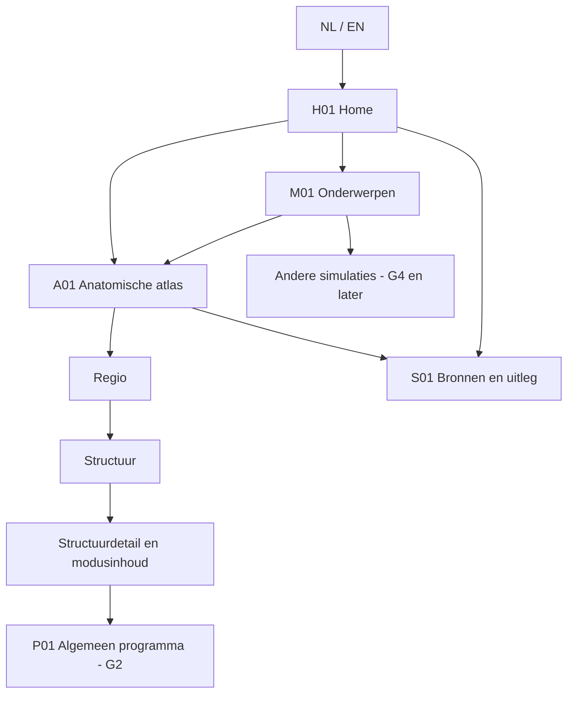

# UX-01 — Informatiearchitectuur en navigatieblauwdruk

**Status:** ontwerpcontract voor implementatie en review, geen bewijs van gebruiksonderzoek of gebouwde functionaliteit.  
**Eigenaars:** Product/UX Lead en Frontend Lead; review door 3D, anatomie, content, privacy en toegankelijkheid.  
**Basis:** masterplan, ADR-001/005/006/011/013; `contracts/simulation-contract.ts`; Gate 0–4.  
**Producttaal:** Nederlands en Engels. De routes en labels hieronder zijn voorstel; interne ID's en de vijf bestaande `AnatomyMode`-waarden blijven leidend.

## 1. Ontwerpdoel en principes

De bezoeker begrijpt binnen één beeldscherm waar hij is, wat hij kan onderzoeken en hoe hij terugkomt. Het 3D-model is de kaart; de tekstuele structuurboom biedt dezelfde bestemming. De atlas is één applicatie, niet vijf verschillende websites. Navigatie, modelselectie en inhoud vormen één samenhangende ervaring.

1. **Eerst kiezen, dan verdiepen.** Start met het lichaam of de gewenste modus. Laat alleen relevante opties zien; steeds meer detail volgt na een keuze.
2. **Altijd een terugweg.** Toon de huidige regio, structuur, modus en terug-naar-lichaamactie. Zorg dat gebruikers ook zonder 3D-gebaren kunnen navigeren.
3. **Zelfde selectie bij modewissel.** Herstellen, Trainen, Leren, Blessures en Sporten zijn verschillende perspectieven op precies dezelfde structuur. De camera, lagen en selectie blijven behouden.
4. **Geen schijnfunctionaliteit.** Niet ondersteunde modellen, structuren of functies worden niet als bruikbaar aangeboden. Geen placeholders die medische inhoud suggereren.
5. **Geen barrières aan de ingang.** Geen account, vragenlijst, persoonsgegevens, diagnostische stappen of AI-chat. Een bezoeker kan de demo onmiddellijk begrijpen.
6. **Twee gelijkwaardige navigatiemethoden.** Bediening via canvas en via HTML-structuurlijst; focus, selectie en mogelijkheden moeten onderling consistent zijn.

## 2. Sitemap en fasering

De route `/<locale>` is de producthome zodra deze daadwerkelijk wordt gebouwd. De huidige technische placeholder in `public/index.html` blijft fase 0; verwar deze niet met een afgeronde producthome.

| ID | Bestemming | Routevoorbeeld NL | Routevoorbeeld EN | Ingang | Gate |
|---|---|---|---|---|---|
| H01 | Home | `/nl` | `/en` | Root, logo | G0/G1 |
| A01 | Atlas, volledig lichaam | `/nl/anatomie/lichaam?modus=leren` | `/en/anatomy/body?mode=learn` | Start atlas, moduskaart | G0 |
| A01-R | Atlas, regio | `/nl/anatomie/lichaam/schouder?modus=leren` | `/en/anatomy/body/shoulder?mode=learn` | 3D, boom, zoeklijst | G0/G1 |
| A01-T | Atlas, aangewezen structuur | `/nl/anatomie/lichaam/schouder/links/deltoideus?modus=leren` | `/en/anatomy/body/shoulder/left/deltoid?mode=learn` | 3D, boom, zoeklijst | G0, na mapping |
| P01 | Programmaoverzicht | `/nl/programmas` | `/en/programs` | Goedgekeurde trainings-/bewegingsinhoud | G2 |
| P01-D | Programmadetail | `/nl/programmas/<public-id>` | `/en/programs/<public-id>` | Programmaoverzicht of inhoudskaart | G2 |
| S01 | Bronnen, modelcredits en beperkingen | `/nl/bronnen` | `/en/sources` | Permanente footer/link in atlas | G0 |
| S02 | Bediening / toegankelijkheid | `/nl/uitleg` | `/en/help` | Hulpknop, fallback, footer | G1 |
| S03 | Privacy / gebruikskader | `/nl/privacy` | `/en/privacy` | Footer; programma-informatie | G1/G2 |
| M01 | Onderwerpenoverzicht | `/nl/onderwerpen` | `/en/subjects` | Hoofdnavigatie | G4 |
| M02 | Actieve niet-anatomische simulatie | `/nl/onderwerpen/<subject-slug>` | `/en/subjects/<subject-slug>` | Beschikbare modulekaart | G4+ |

**Route-opmerkingen:** A01-R en A01-T zijn toestanden van dezelfde atlaslayout, geen afzonderlijk gemounte 3D-viewers. Het pad met schouder/deltoideus uit het masterplan blijft een ontwerpvoorbeeld. De definitieve routeadapter resolveert een stabiele, unieke `canonicalId`; links/rechts worden expliciet opgenomen waar nodig. Een legacy-pad zonder zijde mag niet stilzwijgend een willekeurige zijde kiezen. Een niet-eenduidige slug toont een keuze tussen de daadwerkelijk beschikbare structuren. Redirects zijn alleen toegestaan bij een gecontroleerde unieke alias. Het publieke `<public-id>` van een programma is niet de lokale voortgang en bevat nooit persoonsinformatie.

**Gateonderscheid:** Gate 0 bewijst H01→A01→A01-T en dezelfde route via een modus; Gate 1 maakt de atlas stabiel en toegankelijk; Gate 2 completeert inhoud en het optionele programma; Gate 3 breidt de bediening uit; Gate 4 activeert een tweede onafhankelijk onderwerp. Geen navigatie naar onafgemaakte onderdelen als primaire actie.

## 3. Verdiepingsmodel: vier navigatieniveaus

| Diepte | Betekenis | UI toont | Voorbeeld | Terugactie |
|---|---|---|---|---|
| 0 | Onderwerp | Onderwerpkaart of alleen actieve atlas | Anatomie | Home |
| 1 | Gehele scene | Model, hoofdregio's, beschikbare systemen | Menselijk lichaam | Home/onderwerp |
| 2 | Regio | Gefocust lichaamsgebied, structuurlijst met systeemfilter | Linkerschouder | Volledig lichaam |
| 3 | Structuur | Geselecteerde structuur, naam, modusinhoud, verwante structuren | Linker deltoideus | Schouder |
| 4 | Educatieve subdetail | Dezelfde selectie, les/animatie of verdere inhoud; eventueel een afzonderlijk goedgekeurd schaalmodel | Spiervezel of bewegingsuitleg | Structuurdetail |

Een 3D-zoom verandert op zichzelf geen navigatiediepte. Een expliciete keuze in het canvas of in de boom verandert de geselecteerde ID en kan de camera focussen. Verwante structuren zijn kruislinks, geen onjuiste ouder-kindrelaties; leg relaties vast in catalogusdata. Schakelen naar cel/microscopie is pas mogelijk als een apart model is goedgekeurd; toon de schaalwisseling expliciet (G4), geen geometrisch gefingeerde fysieke continuïteit.

### 3.1 Geschiedenis en teruggedrag

- Navigatie naar een nieuwe regio/structuur of expliciete modewissel maakt een geschiedenisitem; selectie via canvas en lijst volgt dezelfde routeadapter.
- Camera-orbit, zoom, pan, tijdelijk hoveren en lagen aanpassen veroorzaken geen afzonderlijke browsergeschiedenisitems.
- Breadcrumb naar de ouder is een hiërarchische actie, terwijl browser-terug de daadwerkelijke geschiedenis volgt. De knop `Volledig lichaam` is een expliciete bestemmingsactie, geen `history.back()`.
- Browser forward/reload herstelt de selectiedoelstelling en modus uit de geldige URL. Eventuele camerafocus volgt de geselecteerde structuur; een link hoeft geen exacte camera-orbit of verborgenlagen te bevatten.
- Verouderde canonieke IDs: zoek een vastgelegde migratie in de aliascatalogus; bij ontbrekende mapping meld dat de structuur niet beschikbaar is en bied regio/lichaam aan, zonder stilzwijgend andere anatomische inhoud te tonen.
- Locale-wissel leidt naar dezelfde canonieke selectie in de nieuwe taal. Als de vertaling ontbreekt, blijft de structuur geselecteerd en verschijnt een eerlijke melding; mode/camera/lagen blijven gelijk.

### 3.2 URL-state versus applicatiestate

| State | Opslag | Regel |
|---|---|---|
| `locale`, `subject`, `selectedId`, `mode` | Route + centrale store | Canoniek ID via taalneutrale route-resolver; NL/EN slugs zijn geen database-ID |
| `visibleLayerIds`, camera, isolatie, tijdelijk paneel | Centrale scene/store | Onthoud tijdens sessienavigatie; geen verplichting deze in een deep link op te nemen |
| `explodeAmount`, clipping, animatietijd | Module/store, gated | Alleen als module capability dit ondersteunt; niet persistente gebruikershistorie |
| `selectedProgramId`, `currentWeek`, `completedLessonIds` | Lokale browserstorage, G2 | Nooit URL, analytics-event of serverlog; uitsluitend minimale voortgang |
| Zoektekenreeks | Vluchtige UI-state | Geen querytekst in URL, analytics, serverlogging of localStorage |
| Tijdelijke laad-/foutstatus | Runtime-state | Alleen generieke, geschoonde foutcodes naar eventuele technische observability |

Deep links zijn publieke anatomische/informatieve bestemmingen. Houd ook URI-paden en modewaarden buiten gebruiksanalyses die gebruikersinteresse in blessures als gezondheidsgegevens zouden kunnen reconstrueren. Geen vrije tekst of medisch profiel in de route. Maak geen automatische deelknop met gevoelige state.

## 4. Scherm- en inhoudskaart

De UI-ontwerper bepaalt definitieve grid, maten en visuele componentdetails. Dit document bepaalt de semantische volgorde en verantwoordelijkheden, zodat de lay-out later zonder navigatiebreuk kan wijzigen.

### H01 — Home

1. Header: productnaam/logo, actieve primaire bestemming, taal, hulp waar beschikbaar.
2. Hero: korte uitleg wat de atlas doet en wat hij niet doet; één primaire CTA `Open de 3D-atlas`. Geen fictief aantal structuren of claim van compleetheid.
3. Vijf moduskaarten als tweede ingang; `Leren` is standaard voor neutrale atlasstart. Andere kaarten activeren dezelfde viewer met gekozen modus, bij voorkeur met expliciet beschikbare inhoud. Geen automatische medische aanbeveling.
4. Korte uitleg `Zo werkt het`: kies, draai/zoom, selecteer, verdiep; tekstueel equivalent voor niet-visuele gebruikers.
5. Bronnen/credits en educatief gebruikskader in footer.

### A01 — Atlas, alle dieptes

1. Contextbalk: `Anatomie`, breadcrumb en zichtbare modusselectie.
2. Structuurnavigatie: lokaal zoeken, beschikbare regio's en hiërarchische structuren (selecteerbaar als HTML-bediening), alleen daadwerkelijk beschikbare datasets/systemen.
3. Viewer: model, camera-acties, modelstatus, selectie-indicator. Een knop `Naar structuurinformatie` biedt een directe route naar het detailpaneel.
4. Details: huidige structuur/gebied, zijde indien relevant, samenvatting, huidige modus, beschikbare educatieve items, verwante links, bron/reviewstatus.
5. Hulpmiddelen: lagen, focus, isolatie, reset; geavanceerde acties alleen via capability + relevante gate. Een hulpmiddel is nooit een bestemming in de breadcrumb.
6. Beschikbare fallback: tekstuele structuurboom en gecontroleerde informatie blijven bruikbaar bij WebGL-probleem; eventueel gevalideerd statisch beeld als aanvulling.
7. Permanente credit-/beperkingenlink.

**Mobiele leesvolgorde:** context en modus → 3D + bedieningsknoppen → tab/knop `Structuren` of `Informatie` met onthouden selectie. De panelen mogen als drawer/bottomsheet openen, maar essentieel gereedschap en actuele selectie moeten bereikbaar blijven. Alleen één modale overlay tegelijk; focus terug naar opener na sluiten. Geen horizontal scrolling voor navigatieknoppen als primaire oplossing. De toolbar mag eenvoudige acties groeperen in een duidelijk gelabeld `Meer`-menu.

### P01 / P01-D — Algemeen programma (G2)

- Overzicht van algemeen, inhoudelijk goedgekeurd programma; toon doel, materiaal, duur, startvoorwaarden, geschiktheidsbegrenzing en broninformatie.
- Detail: weeklijst 1–8, expliciete `Start programma`, bestaande lokale voortgang en wisactie. Geen vragenlijst, passendheidsalgoritme of persoonlijke behandelkeuze.
- Een gebruiker kan een week zelfstandig openen of voltooien; geen medische conclusie uit niet-voltooiing.
- Leg zichtbaar uit dat voortgang op deze browser blijft en verloren kan gaan als browserdata wordt gewist.
- Terug naar atlas behoudt selectie zolang de app dit ondersteunt; programma is aanvullend, geen vereiste om de atlas te gebruiken.

### S01 / S02 / S03 — Vertrouwen, hulp, privacy

- Bronnen: hardware/modelversie, geometrische bronnen/licenties/attributie, afzonderlijke inhoudsbronnen; geen onbewezen `100% anatomisch correct`-claim.
- Hulp: bediening per invoermethode, mobiele gebaren, toegang tot tekstmodus, reset en praktische uitleg van de gezichtsrichting.
- Privacy: uitsluitend educatief platform; lokale opslag van programmavoortgang; leg verwijderen/wissen uit; geen account of gezondheidsvragen. Afzonderlijke review vóór backend of betaalfunctie.

### M01 / M02 — Uitbreidingsroute (G4+)

- Onderwerpkaarten met naam, korte omschrijving en beschikbaarheidsstatus. Toon alleen werkende modules als interactief; eventueel aparte informatieve lijst `Gepland` zonder nepstartknoppen.
- Niet-anatomische module gebruikt dezelfde route-/vieweromgeving uitsluitend voor gedeelde bedieningspatronen. Geen anatomiemodi op zonnestelsel, natuurkunde of chemie tenzij daar afzonderlijk een domeincontract voor bestaat.
- Toon vakspecifieke eenheden, modellimieten, tekstuele alternatiefcontent en een duidelijke terug-naar-onderwerpenactie.
- Schakelen onderwerp maakt de oude module netjes vrij; geen doorlekken van anatomische selectie, laagstatus of animaties naar nieuwe module.

## 5. Vijf modi: onafhankelijke presentatie, gedeelde structuur

| Interne waarde | NL label | EN label | URL-waarde EN | Inhoudsdoel |
|---|---|---|---|---|
| `herstellen` | Herstellen | Recovery | `recovery` | Algemene educatie over belasting, rust en herstel; geen individueel behandelplan |
| `trainen` | Trainen | Training | `training` | Gecontroleerde voorbeelden van bewegingspatronen en spierfunctie |
| `leren` | Leren | Learn | `learn` | Anatomische vorm, ligging, functie en relaties |
| `blessures` | Blessures | Injuries | `injuries` | Uitleg van algemene letselbegrippen, grenzen en wanneer professionele hulp nodig kan zijn; geen diagnose |
| `sporten` | Sporten | Sports | `sports` | Algemene sportbewegingen en biomechanica, geen persoonlijke prestatieclaims |

Standaard `leren`. Bij selectie van een modus zonder goedgekeurde content blijft het model en de geselecteerde structuur intact en verschijnt een neutrale beschikbaarheidsmelding met een knop naar `Leren`. Voeg geen gegenereerde tekst toe om het gat te vullen. Gate 0 kan de visuele modeflow aantonen met expliciet gemarkeerde conceptdata in een niet-productietest; publicatie van medische claims vereist inhoudsgoedkeuring.

## 6. Labels, microcopy en zoekstructuur

Vaste kernlabels worden centraal als i18n-keys beheerd; woorden in `[]` zijn dynamische, vertaalde labels, geen vrije medische invoer. Taalkeuze respecteert de gebruiker en is geen automatische geolocatie. Canonieke ID's worden niet letterlijk als titels weergegeven.

| Key | NL | EN |
|---|---|---|
| `nav.home` | Home | Home |
| `nav.atlas` | Anatomische atlas | Anatomy atlas |
| `nav.subjects` | Onderwerpen | Subjects |
| `nav.programs` | Programma's | Programs |
| `nav.help` | Hulp en bediening | Help and controls |
| `nav.sources` | Bronnen en credits | Sources and credits |
| `atlas.start` | Open de 3D-atlas | Open the 3D atlas |
| `atlas.fullBody` | Volledig lichaam | Full body |
| `atlas.regions` | Lichaamsregio's | Body regions |
| `atlas.structures` | Structuren | Structures |
| `atlas.details` | Informatie | Information |
| `atlas.mode` | Kies een modus | Choose a mode |
| `atlas.search` | Zoek anatomische structuren | Search anatomical structures |
| `atlas.layers` | Lichaamslagen | Body layers |
| `atlas.focus` | Focus op selectie | Focus on selection |
| `atlas.isolate` | Isoleer selectie | Isolate selection |
| `atlas.restore` | Toon alle gekozen lagen | Show all chosen layers |
| `atlas.resetCamera` | Reset camera | Reset camera |
| `atlas.resetLayers` | Reset lagen | Reset layers |
| `atlas.clearSelection` | Deselecteer | Clear selection |
| `atlas.toInfo` | Naar structuurinformatie | Go to structure information |
| `atlas.textMode` | Open tekstmodus | Open text mode |
| `atlas.loading` | Model wordt geladen… | Loading model… |
| `atlas.loadRetry` | Probeer opnieuw | Try again |
| `atlas.left` | Links | Left |
| `atlas.right` | Rechts | Right |
| `atlas.source` | Bron en modelversie | Source and model version |
| `atlas.related` | Verwante structuren | Related structures |
| `content.reviewed` | Inhoud gecontroleerd | Content reviewed |
| `content.unavailable` | Voor deze selectie is nog geen gecontroleerde informatie beschikbaar. | Reviewed information is not yet available for this selection. |
| `privacy.educational` | Educatieve informatie; geen persoonlijke diagnose of behandeladvies. | Educational information; not a personal diagnosis or treatment recommendation. |

### Zoekfunctie (G1)

De index bestaat uitsluitend uit beschikbare anatomische structuren en hun gecontroleerde namen, synoniemen, regio, systeem en zijde. Gebruik NL/EN en geverifieerde Latijnse namen waar beschikbaar. Normaliseer hoofdletters/accenten, geef exacte match prioriteit, groepeer identieke zoekresultaten per regio en zijde; resultaten tonen `naam · zijde · regio · systeem`. Zoek niet naar symptomen, aandoeningen of vrije medische vragen; zoektekst gaat niet naar een LLM, zoekservice, queryparameter of analytics. Geef bij niet gevonden structuur suggestie om te zoeken op anatomische naam of regio, zonder medische interpretatie van de invoer. Indexlabels zonder betrouwbare assetmapping mogen uitsluitend in tekstcatalogus verschijnen met duidelijke label `Niet beschikbaar in 3D` als zulke tekst inhoudelijk is goedgekeurd.

## 7. Kerngebruikersroutes en overdrachtsmomenten

| Flow | Verloop | Verifieerbare uitkomst |
|---|---|---|
| F01 — Neutrale start | H01 → `Open de 3D-atlas` → regio schouder → selecteer daadwerkelijk geïmporteerde schouderstructuur | A01-T, canonieke ID en titel komen overeen met geselecteerde mesh; `leren` actief |
| F02 — Modus als ingang | H01 → `Trainen` → dezelfde regio/structuur | Zelfde canonieke ID als F01; andere modus, geen tweede viewer |
| F03 — Snel wisselen | A01-T → Blessures → Sporten → Leren | Selectie en camera gelijk; content resolver wisselt uitsluitend mode/locale |
| F04 — Zonder 3D | H01 → atlas → tekstmodus of structuurboom → regio → structuur | Dezelfde gecontroleerde inhoud bereikbaar, zonder WebGL of pointer |
| F05 — Terug/niveau | Structuur → breadcrumb regio → volledig lichaam | Parentrelatie klopt; expliciete focus op gekozen niveau; browser-terug werkt |
| F06 — Zoek en vind | Atlas → anatomische zoekterm → kies resultaat links/rechts → detail | Correcte unieke ID en zichtbare zijde; geen medische interpretatie |
| F07 — Taalwissel | NL op A01-T → EN → NL | Zelfde onderwerp, selectie en mode; vertaalde naam/bron of eerlijke ontbrekende vertaling |
| F08 — Heropening deeplink | Open gecontroleerde URL naar structuur en mode in schone browser | Titel/ID/scene consistent; geen persoonsgegevens in link |
| F09 — Programma (G2) | Goedgekeurde algemene uitleg → programmadetail → start → voltooi les → vernieuw → wis | Alleen minimale lokale gegevens; duidelijke reset; geen diagnose of profiel |
| F10 — Tweede onderwerp (G4) | Atlas → onderwerpkeuze → actieve tweede module → terug naar atlas | Correcte modulelifecycle; eigen scope/eenheden; geen verouderde anatomy-state in andere module |

De UX Lead levert voor iedere flow een klikbaar wireframe of prototypeopname; de Frontend Lead koppelt bestemmingen, de 3D Lead selecties en camera, Content Lead de correcte vertaalde records, QA maakt een E2E-scenario. De anatomie-reviewer bevestigt dat de gekozen voorbeeldstructuur daadwerkelijk met assets en inhoud overeenkomt.

## 8. Lege, laad-, fout- en randtoestanden

| Situatie | Primair gedrag | Hersteloptie / microcopy |
|---|---|---|
| Eerste bezoek, geen selectie | Toon volledig lichaam indien geladen, hoofdregio's en instructie; geen fout | `Kies een lichaamsregio of selecteer een structuur.` |
| Dataset laadt | Reserveer ruimte, zichtbare progress indien werkelijke meting bekend; behoud nav/fallback | `Model wordt geladen…` en `Open tekstmodus` indien beschikbaar |
| Asset ontbreekt of laden faalt | Geen namaakmodel of willekeurige selectie; generieke foutcode | `Het 3D-model kan nu niet worden geladen. Probeer opnieuw of gebruik tekstmodus.` |
| WebGL niet ondersteund of context verloren | Behoud selectie, modus, boom en inhoud buiten canvas | `3D is niet beschikbaar op dit apparaat.` / `Open tekstmodus` / gecontroleerde herlaadactie |
| Geen zoekresultaten | Toon geen diagnostische suggestie | `Geen structuur gevonden. Probeer een lichaamsregio of anatomische naam.` |
| Slug ambigu | Toon expliciete lijst van mogelijke geldige structuren | `Kies welke structuur je bedoelt.` |
| Structuur niet beschikbaar | Geen automatisch vervangende weergave; behoud context indien betrouwbaar | `Deze structuur is niet beschikbaar in het huidige model.` / ga naar regio of lichaam |
| Onbekend systeem/laag | Verberg unsupported controle; herstel vooraf bekende veilige layer-default | `Deze laag is in dit model niet beschikbaar.` |
| Alle gekozen lagen verborgen | Toon visuele melding met duidelijke resetactie | `Er zijn geen zichtbare lagen. Reset de lagen of zet een laag aan.` |
| Selectie verborgen door laag/isolatie | Houd structurele selectie, toon status `Niet zichtbaar in huidige lagen`; wijzig zichtbaarheid alleen via expliciete actie | `Toon geselecteerde structuur` |
| Inhoud ontbreekt/ongecontroleerd | Geen onbevestigde claims; behoud model en selectie | `Voor deze modus is nog geen gecontroleerde informatie beschikbaar.` / `Ga naar Leren` |
| Vertaling ontbreekt | Benoem welk taalrecord niet beschikbaar is; alleen toegestane, gelabelde taalalternatief aanbieden | `Deze informatie is nog niet beschikbaar in jouw taal.` |
| Lokale programmavoortgang niet schrijfbaar | Geen vals succes, laat programma-inhoud toegankelijk | `Voortgang kan niet worden opgeslagen in deze browser.` |
| Geavanceerde functie niet ondersteund | Ontbrekende capability maakt bediening niet beschikbaar; geen dead control | Geen knop tenzij informatief nodig; eventueel uitleg in hulp |

Statusveranderingen zijn ook tekstueel aangekondigd; laadstatussen blokkeren alleen de afhankelijke functie. Focus wordt niet willekeurig verplaatst bij camera-animaties of renderupdates. Bij een fout blijft de bedieningsinterface bruikbaar.

## 9. Implementatiecontracten en eigenaar

| Werkpakket | Owner | Vereiste artefacten | Acceptatie |
|---|---|---|---|
| IA-01 route/locale-adapter | Frontend + Architect | Canonieke ID/slugs, mapping NL/EN, alias/migratie, URL tests | F01/02/05/07/08 |
| IA-02 gedeelde atlas-shell | UX + Frontend + 3D | Componentboom en state-overdracht, viewer mount-count test | F01/02/03; geen viewer duplicatie |
| IA-03 structuurcatalogus en zoeken | Anatomie + Content + Frontend | Catalogus, synoniemen, zijde, mapping, beschikbare structuurstatus | F04/06; geen valse mesh-ID |
| IA-04 fallback en toegang | Frontend + QA + toegankelijkheid | HTML structuurboom, benoemde knoppen, focusroute, statusmeldingen | F04, foutmatrix |
| IA-05 modusinhoud | Content + reviewer | Inhoud per canonieke ID, mode, locale, reviewstatus en bronniveau | F03/07; geen draft in productie |
| IA-06 programmanavigatie | Product + privacy + frontend | Programmaflow, lokale storage en wisactie | F09; netwerkinspectie |
| IA-07 modulekeuze | Architect + UX + sim-engineer | Modulemanifest, zichtbare availability en capability UI | F10; lifecycle-test |

ID's zijn werkpakketvoorstellen; nog geen GitHub Issues. `G0-08` gebruikt IA-01/02 in beperkte POC-vorm; `G1-01/02/05/06` completeert IA-basis; Gate 2/4 wachten op hun eigen go/no-go.

## 10. Concrete gebruikersacceptatiecriteria

- [ ] Vanuit H01 bereik je in maximaal drie expliciete bestemmingskeuzes de eerste gecontroleerde structuur (atlas → regio → structuur); zoom/pan is niet nodig voor essentiële navigatie.
- [ ] Twee ingangen (neutraal en moduskaart) leveren bij dezelfde structuurkeuze exact dezelfde `selectedId` en juiste modus; 3D-renderer mount niet opnieuw doordat modus of locale wijzigt.
- [ ] Voor ieder van de vijf modi kan QA wisselen zonder selectie, camera of actieve laagconfiguratie te verliezen. Niet-goedgekeurde content valt terug op beschikbaarheidsmelding.
- [ ] Browser-terug/forward/reload en directe URL's passeren resolver-tests voor beide talen, links/rechts, onbekende ID's en gecontroleerde aliases.
- [ ] Selectie via canvas en HTML-boom convergeren naar dezelfde ID en zichtbare structuurcontext. Keyboard/screenreader kunnen de kernroute volledig doorlopen zonder canvas-pointer.
- [ ] Een ontbrekende assetmapping wordt nooit als een bestaande anatomische structuur gepresenteerd; niet-zichtbare selecties krijgen een expliciete status en herstelactie.
- [ ] Op mobiel en desktop blijft de gebruiker bij iedere kernroute weten welke regio, structuur en modus actief zijn en kan hij via zichtbare bediening terugkeren. Test op 320 CSS-px en afgesproken grotere viewports zonder horizontaal scrollende hoofdnav.
- [ ] NL/EN kernlabels, foutmeldingen en helpteksten komen uit het woordenboek; ontbrekende locale geeft een zichtbare melding, niet een cryptische i18n-key.
- [ ] Bij geen WebGL, contextverlies en geforceerde load-fout blijven regio-/structuurlijst, broninformatie en gecontroleerde tekst bruikbaar.
- [ ] Bron/attributie bereikbaar vanuit atlas zonder verlies van context; geen onbewezen claims in labels of eerste scherm.
- [ ] Geen symptoomvragen, AI-chat, diagnose, persoonlijke gegevens of medische gebruikerslogs. Audit deep links, telemetry, zoekfunctie en storage.
- [ ] Gate 2 opslag bevat alleen gekozen programma en voortgang; reset/wissen is expliciet, lokaal en getest.

**Benodigde testbewijzen:** route-eenheidstests; E2E-scenario's F01–F08 op desktop en mobiel; keyboard- en screenreadersessie; geforceerde WebGL-fallback; ontbrekende dataset/contentfixture; NL/EN-screenshots; inhouds- en licentiereview. Pas na geslaagde Gate 0/Gate 1 kan een echte productrelease worden overwogen. F09/F10 horen bij latere gates.

## 11. Open ontwerpbesluiten en validatie

1. Definitieve anatomische regio- en structuurhiërarchie hangt af van gecontroleerde assetmapping. De deltoideusroute is een voorbeeld, geen verklaring dat een concrete mesh is gevalideerd.
2. Definitieve slugs en legacy aliases worden door frontend/content na modelaudit vastgelegd; zorg dat een taalwissel dezelfde canonical ID behoudt.
3. Exacte responsive panelen, prioriteit van tools en mobiele toegankelijkheidsoplossingen worden afgestemd op de afzonderlijke schermblauwdruk en echte device-tests.
4. Onderzoek met gebruikers of moduslabels en de route `lichaam → regio → structuur` begrijpelijk zijn; vaststellen in een taakgebaseerde testsessie, niet op basis van mening of ongefundeerde percentages.
5. Laat privacy- en observability-review bepalen hoe eventuele router-/hostinglogs worden beperkt of geschoond, ook als URL's alleen publieke anatomische informatie dragen.
6. Beslis pas na Gate 1 of de onderwerpenoverzichtkaart of de neutrale atlas-home als primaire ingang voor toekomstige modules het beste werkt. De routeadapter en shell moeten beide toelaten.
