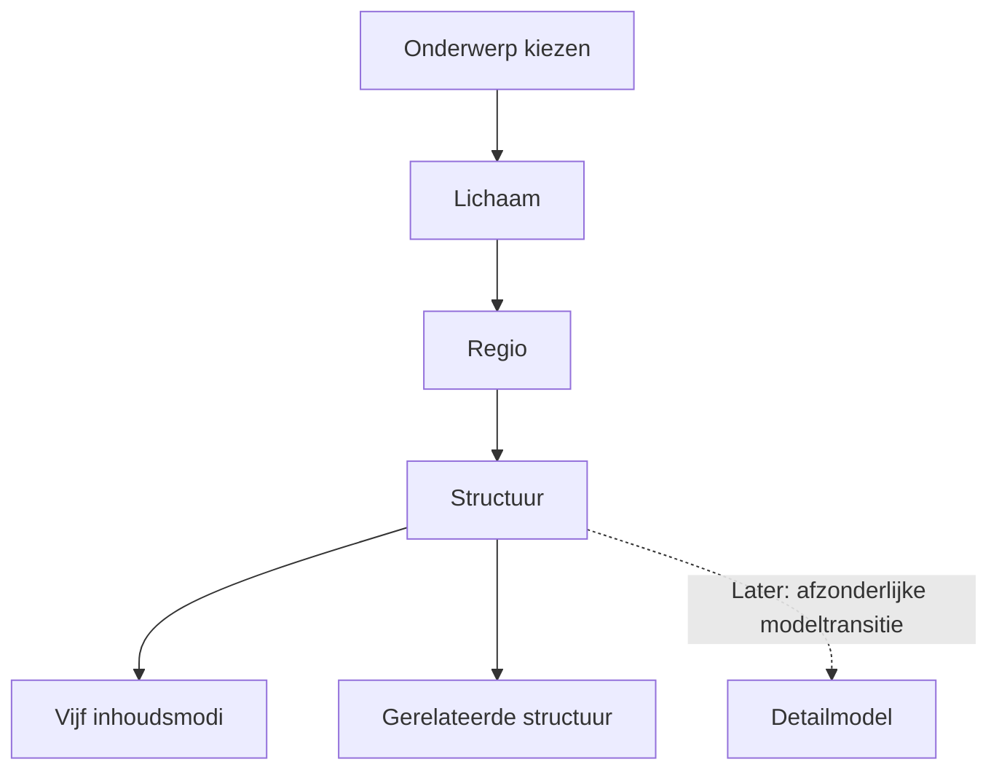

# UX-03 — 3D-interactie, navigatie en biomechanica

**Status:** implementatieblauwdruk (voorstel, geen gerealiseerde viewer of empirisch bewezen hardwareprestaties). **Eigenaar:** 3D/interaction engineer; mede-reviewers UX, architect, anatomie, QA, assetbeheer en toegankelijkheid. **Afhankelijkheden:** `docs/01-MASTERPLAN.md`, `docs/03-3D-EN-DATAMODEL.md`, `contracts/simulation-contract.ts`, `planning/05-ROADMAP-EN-BACKLOG.md` en `planning/06-RISICOS-EN-TESTPLAN.md`. Dit document concretiseert bestaande besluiten en verandert de eerste release niet stilzwijgend.

## 1. De ervaring: één lichaam, één selectie, verschillende perspectieven

De interactieve werkruimte is één atlas met een centrale 3D-scène, een doorzoekbare HTML-structuurboom en een inhoudspaneel. De vijf anatomische modi zijn inhoudsperspectieven op dezelfde selectie: nooit vijf afzonderlijke scènes of zoekbomen. De gebruiker ziet altijd het actuele onderwerp, de regio, de structuur, de actieve modus en de schaal, als leesbare labels buiten het canvas. Ook zonder 3D kan de gebruiker iedere bereikbare structuur en beschikbare uitleg vinden.



### Mijlpalen en functionaliteit

| Functie | Eerste POC / Gate 0 | V1 / Gate 1–2 | Later / Gate 3–4 |
|---|---|---|---|
| Camera | orbit, zoom, reset, focus op één betrouwbare schouderstructuur | pan, begrenzing, perspectiefpresets, toegankelijke equivalente bediening | extra camera-presets per module |
| Selectie | 3D-pick en tekstkeuze, eigen stabiele ID | structuurboom, zoeken, hiërarchie, keyboard, deselectie, deep links | grote catalogi en relaties |
| Lagen | controle over één of enkele aantoonbaar gemapte systemen | zichtbare lagen, isoleren, individueel verbergen, volledige zichtbaarheid herstellen | optionele transparantie, complexere tree-filtering |
| Inhoud | NL/EN, vijf modi behouden ID; alleen gevalideerde inhoud | volledige eerste educatieve regio; ontbrekende inhoud eerlijk vermelden | uitgebreidere catalogus, videobibliotheek |
| Beweging | niets afspelen zonder gecontroleerd model | Gate 2: één gecontroleerde animatie, pauze, beschrijving, ondertiteling | tijdlijn, meerdere gecontroleerde bewegingen |
| Uiteenhalen / doorsnede | niet aanwezig | niet actief tenzij Gate 3 is behaald | explode en clipping inclusief reset, tests en fallback |
| Microschaal / andere wetenschappen | niet aanwezig | eventueel neutrale roadmap-indicatie | separate scènes per schaal, modulecontract Gate 4 |

De gebruikersinterface toont alleen bedienbare, ondersteunde functies: geen knoppen met een 'succes'-melding voor nog niet beschikbare modelmogelijkheden. Een roadmapkaart mag apart tonen wat later gepland is. Verschillende browsers mogen aantoonbaar verschillende GPU-mogelijkheden hebben; essentiële kennis blijft beschikbaar.

## 2. Vieweropbouw en bedieningsvolgorde

In de viewer-shell bevinden zich (in lees-/focusvolgorde) terug naar onderwerp, active breadcrumb, vijf modi, 3D-werkruimte met werkbalk, toegankelijke structuurboom/filter, inhoud, gerelateerde structuren en bron/attributie. Op mobiel worden boom en inhoud als twee niet-overlappende tabs/panelen onder of naast het canvas ontsloten. De werkbalk blijft beschikbaar zonder over modellen te slepen. Het interfaceontwerp bepaalt exacte plaats en styling; deze specificatie bepaalt gedrag en minimumfuncties.

| Actie / NL | EN | Muis/toetsenbord | Aanraking / alternatief | Resultaat |
|---|---|---|---|---|
| Object selecteren | Select structure | primaire klik, `Enter` op HTML-item | korte tik, tik op boomitem | actuele ID + highlight + inhoud |
| Draaien | Orbit | slepen primair; pijlen binnen gefocuste viewer-controls | slepen met één vinger; pijltjestoetsknoppen | verandert camera, niet selectie |
| Pannen | Pan | middelste knop of `Shift`+slepen; pijlen in panmodus | twee vingers parallel; panmodus/pijlknoppen | target verplaatsen |
| Inzoomen / uitzoomen | Zoom in / out | scroll alleen op actieve viewport; `+` / `−` in werkbalk | pinch; `+` / `−` knoppen | afstand binnen grenzen |
| Focus selectie | Focus selection | zichtbare knop, `F` indien viewer gefocust | knop | kader rond zichtbare structuur |
| Volledig lichaam | Fit body | knop / `Home` binnen viewer-controls | knop | frame volledige lichaam, huidige selectie en lagen behouden |
| Camera-aanzicht | View orientation | expliciete keuze Voor/Achter/Links/Rechts | dropdown / knoppen | bepaald anatomisch aanzicht, geen modelrotatie |
| Lagen | Layers | checkboxen buiten canvas | tik op laagmenu | zichtbaarheid per systeem |
| Isoleer selectie | Isolate selection | toggle met status | knop | alleen actieve structuur zichtbaar, omkeerbaar |
| Verberg structuur | Hide structure | expliciete knop | knop | verbergt de geselecteerde mesh; ID en uitleg blijven |
| Herstel zichtbaarheid | Restore visibility | knop | knop | herstel initial layers, leeg hidden, isolatie uit |
| Wis selectie | Clear selection | `Esc` binnen viewer/in selectie-context; knop | knop | ID null; contextpaneel toont regio/atlasintro |
| Reset weergave | Reset view | knop | knop | camera, filters, isolate, selectie en effecten terug naar moduledefault |
| Bekijk lijstweergave | Text / list view | knop of skiplink | knop | volledig alternatief, geen verlies van selectie |

- Werkbalkknoppen gebruiken `button` + toegankelijke naam (tekst of `aria-label`) en `aria-pressed` bij toggles; status is niet uitsluitend een kleur. Een label toont de huidige geselecteerde structuur en bijvoorbeeld „Buiten beeld” / „Hidden” indien nodig. De lijst gebruikt gewone HTML en duidelijke focusmarkering; een lijstboom wordt alleen een ARIA-tree als alle bijbehorende toetsenbordsemantiek correct is geïmplementeerd.
- Trek geen pagina-sneltoetsen naar de 3D-canvas. Shortcutverwerking alleen bij gefocuste viewer/bediening, nooit tijdens typen, in een selectmenu of dialoog. `Tab` verlaat de viewer. `Esc` sluit eerst een geopend menu/paneel, daarna is deselectie mogelijk.
- Scroll/gebaren zijn alleen aan de 3D-viewport gebonden. Buiten de viewport blijft pagina-scroll normaal; op mobiel blijft een duidelijke tab/pagina-oppervlakte scrollbaar. Uit de viewer stappen vraagt nooit browserterug. Een verkleinde viewport biedt dezelfde expliciete knoppen als een grote.

## 3. Statecontract en enkelvoudige waarheid

Voorgesteld hoststore-model (interfaces worden met de architect gevalideerd; de huidige SDK blijft v0.1 tot akkoord op eventuele uitbreidingen):

```ts
type CameraState = {
  target: readonly [number, number, number]; distance: number;
  azimuth: number; polar: number; preset: 'free'|'front'|'back'|'left'|'right';
};
type ViewerState = {
  subject: SubjectId; locale: Locale; mode: AnatomyMode;
  regionId: string | null; selectedId: string | null;
  visibleLayerIds: readonly string[]; hiddenIds: readonly string[];
  isolateIds: readonly string[] | null;
  camera: CameraState;
  explodeAmount: number; // 0..1; altijd 0 in POC/V1
  clip: { enabled: boolean; axis: 'x'|'y'|'z'; normalizedOffset: number };
  playback: 'stopped'|'paused'|'playing'; playbackTime: number;
  presentation: '3d'|'list'; status: 'loading'|'ready'|'error'|'fallback';
  reducedMotion: boolean; sceneRevision: number;
};
```

`SubjectId`, `Locale`, `AnatomyMode` volgen het bestaande conceptcontract. Runtime-state, URL-state en renderer-state hebben afzonderlijke verantwoordelijkheden. De host beheert de autoritatieve ID's, lagen, modus en taal; de module/adaptor beheert geometrie, picking, matrixupdates en capabilities. Het contentpaneel leest uitsluitend `selectedId`, `mode`, `locale` en publicatieversie; het mag niet afhankelijk zijn van meshlabels of camera-positie. Tijdelijke cameratweens/hover/pointerpositie blijven buiten de globale React-state per frame. Synchroniseer camera bij interactie-einde met host, nooit 60 Hz URL-updates.

### Reducer-/actiebeleid

| Actie | Preconditie | Statewijziging / effect | Behoud |
|---|---|---|---|
| `SELECT(id)` | catalogus-ID geldig, juiste subject/revisie | selectedId=id; regionId afgeleid van gevalideerde hiërarchie; highlight; nieuwe inhoud | camera blijft staan; mode/locale behouden |
| `SELECT(null)` | ongeacht renderstatus | selectedId=null; verouderde content verdwijnt | regio, camera en lagen behouden |
| `FOCUS(id)` | ID geldig en zichtbare bounding box | camera target/afstand naar object, preset free | selectie en zichtbaarheid behouden; geen auto-select tenzij expliciete select+focus-actie |
| `CHANGE_MODE(mode)` | anatomie, geldige enum | mode en inhoudsresolver | ID, camera, lagen, regio en isolatie blijven exact behouden |
| `CHANGE_LOCALE(locale)` | geldige locale | labels/content- en route-locale | geen modellading of camera-reset |
| `SET_LAYER(id,on)` | layer-ID uit manifest | basislaagset aanpassen | selectie, isolate en camera blijven |
| `SET_HIDDEN(id,on)` | individueel geldige structuur | hiddenIds aanpassen | selectie en info blijven; label indien onzichtbaar |
| `ISOLATE(id)` | geldig ID; geometry aanwezig | isolateIds naar geldige structuur-set; toon isolatie-indicator | oorspronkelijke laagset en hiddenIds blijven intact |
| `CLEAR_ISOLATE` | isolatie actief | isolateIds=null | behoud onderliggende zichtbaarheid |
| `SHOW_SELECTED` | selectedId geldig, hidden | expliciet passende basislaag aan, hidden verwijderen; indien isolatie elders gericht: huidige isolatie verlaten | camera onveranderd |
| `FIT_BODY` | module geladen of bounds bekend | fit volledige baseline bounds | ID, mode, filters/isolatie onveranderd |
| `RESTORE_VISIBILITY` | atlascontext | manifeste standaardlagen; hidden leeg; isolate null | ID, camera en mode onveranderd |
| `RESET_VIEW` | atlascontext | camera+standaardzichtbaarheid, select=null, effecten uit, playback gestopt, region module-root | huidige subject, mode, locale, toegankelijkheidsvoorkeur; geen programmaprogressie wissen |
| `SET_PRESENTATION(list|3d)` | fallback beschikbaar | wissel weergave | publieke atlasstate blijft |
| `SWITCH_MODULE(next)` | geldige module + capabilitycheck | abort oude load/animatie, sceneRevision++, unmount/cleanup, monteer nieuwe module met defaults | alleen globale taal/reduced-motion en navigatiepad; geen anatomische filters/ID's naar nieuw domein |

Een selecteeractie vanuit de lijst blijft toegestaan voor een door filters verborgen structuur; die selectie toont inhoud en „Verborgen — Toon structuur”. Niets wordt ongemerkt zichtbaar gemaakt. Een expliciete „Toon en focus” knop combineert `SHOW_SELECTED` en `FOCUS` atomair. Als ID onbekend is, wordt `INVALID_ID` geëmit zonder bestaande geldige selectie te wijzigen; bij een ongeldige initiële URL toont de app de geldige dichtstbijzijnde ancestor (als bevestigd) of de module-root met melding, nooit een willekeurige structuur.

### Zichtbaarheidsfunctie

Voor een mesh `m`, gebruik een gevalideerde provider → canonical-ID mapping en de actieve manifestlaag. In standaardmodus geldt `visible = inEnabledLayer && !isIndividuallyHidden`. Bij isolatie geldt `visible = inIsolateSet` (overlay die zelfs een eerder verborgen maar expliciet geïsoleerd object tijdelijk toont); de basislaagset en hidden set blijven onaangetast. UI laat zien dat wijzigingen aan lagen tijdens isolatie pas zichtbaar worden na het beëindigen ervan. Een verborgen geselecteerde structuur kan nog steeds tekstueel worden bezocht; geen onzichtbare highlight op een andere mesh. Bij een actieve doorsnede (later) bepaalt shader-clipping het resterende zichtbare oppervlak, onafhankelijk van zichtbaarheid. Wanneer alle lagen uitstaan blijft camera/structuurnavigatie werken en verschijnt „Geen zichtbare structuren — Herstel zichtbaarheid”.

### URL en browsergeschiedenis

De bestaande canonieke route bevat onderwerp, geldige regio/structuur en mode (`/nl/anatomie/lichaam/schouder/...?...`). POC bevestigt de exacte route en aliassen met IA/architect. `pushState` voor doelgerichte navigatie naar regio/structuur, onderwerp of modus; apparaat-gesture, hover of live slider mag niet per frame geschiedenis vullen. Taalkeuze houdt dezelfde canonieke ID; browser Back/Forward reconstrueert route-gebonden selectie/mode/locale. Onbekende querywaarden worden gevalideerd en genegeerd of met neutrale melding hersteld. Camera, layers en effectwaarden hoeven in V1 niet in de URL; wanneer delen van publieke weergave later wordt toegevoegd, valideer schema/versie en clamp waarden. Deep links bevatten geen gebruikersprofiel, klachten of programmaprogressie. Niet-persistente atlasstate gaat na refresh naar gedocumenteerde defaults, alleen route-informatie wordt hersteld.

## 4. Picking, camera en geometrie

### 4.1 Objectselectie zonder vergissingen

1. `pointerdown` op canvas registreert lokale positie, pointer-ID en actieve actie (niet globale screen-coördinaten).
2. Beweging boven voorgestelde POC-drempel van 8 CSS-pixels, een tweede pointer of browsergesture maakt de interactie een camera-actie, niet selectie. Drempel testen op echte touch/muis; CSS-pixels, onafhankelijk van DPR. `pointercancel` wist de gesture en activeert nooit picking.
3. Alleen afgeronde tap/klik wordt via canvas-relative genormaliseerde coördinaten omgezet naar een ray. Filter verborgen, door clipping weggesneden en niet-selecteerbare hulpgeometrie uit de hitlijst. Neem de dichtstbijzijnde zichtbare geldige hit; bij overlappende/tie hits gebruiken we deterministische afstands-/ID-volgorde.
4. Adapter vertaalt providerkey naar canonieke ID; de host accepteert alleen het geladen catalogusrecord. Meerdere meshes kunnen één ID delen; alle bijbehorende zichtbare meshes krijgen één consistente highlight. Niet-gemapte meshes kunnen zichtbaar zijn als expliciet gemarkeerde achtergrond, maar niet selecteerbaar of inhoudsgekoppeld.
5. Emit select-event precies één keer, update highlight/boom en laad goedgekeurde content. Bij een lege klik: behoud selectie om onbedoelde deselectie op mobiel te vermijden; de knop „Wis selectie” is de expliciete weg terug.

Canvas-highlight krijgt niet alleen kleur (outline/materialbeschrijving plus naam buiten canvas); hover is tijdelijk en mag geen selectie wijzigen. Label- en highlightobjecten zijn niet pickable. Geen wijziging van brongeometrie of materiaalkleuren voor highlights; hergebruik overlaymateriaal en herstel na deselectie. Verborgen meshes staan niet in pick-layers totdat ze weer zichtbaar zijn.

### 4.2 Camera-conventies

- Importeer de werkelijke bronconventies, schaal/units, handedness en oriëntatie; datasetadapter levert anatomisch correcte voor/achter/links/rechts presets. Anatomisch links is de linkerzijde van het model, niet noodzakelijk links op het beeldscherm. Toon een kleine leesbare oriëntatie-indicator met links/rechts, niet alleen een abstracte axis-gizmo. Voor een nieuwe module met niet-anatomische wereldaxes gebruikt UI eigen labels.
- Focus berekent bounding sphere/box op zichtbare gekarteerde objecten in wereldcoördinaten; camera bezet uniforme framing binnen het werkelijk beschikbare viewportgebied (dus rekening houden met paneel en device aspect ratio). Neem fitting-afstand aan de hand van het kleinste horizontale/verticale gezichtsveld plus marge (voorstel 15%, na POC validatie). Near/far aanpassen aan schaal zonder onbedoeld doorsnijden of goedgekeurde detailweergave af te snijden.
- Afstandsgrenzen per scène afleiden uit bounds en minimum herkenbare meshafstand; geen vaste meterwaarde aannemen. POC-voorstel: maximale afstand 8× basisframing, minimale afstand 0,05× lokale bounding sphere-radius, met een minimum passend bij near-plane. Extreme of degeneratieve bounds leveren veilig defaultframing + technische foutmelding in developeromgeving. Pan beperkt tot een vergrote scene-bound zodat reset altijd herstelt; test ook uitschieters door fout geïmporteerde meshes.
- Preset verandert alleen camera, niet oriëntatie van de mesh. Orbit-polar niet op singulariteit: kleine epsilon boven/onder de polen; clamp en normaliseer hoeken na elke bediening. Camera staat stil wanneer geen input of actieve animatie; renderer op aanvraag. Gebruik geleidelijke focusovergang (voorstel 250–400 ms) bij normale bewegingsvoorkeur; bij reduced-motion of lijstmodus directe sprong zonder camera-animatie.
- Nieuwe interactie annuleert lopende focusanimatie. Laat noodgeval reset altijd werken, ook na mislukte focus. Bij `resize`/device-rotatie behoud selectie/camera-target en pas framing aan indien nodig; geen volledige scene remount.

## 5. Vervolgfeatures: explode, clipping, transparantie en animaties

Alleen vrijgeven via capabilities en de gates in bestaande roadmap. V1 heeft deze controls niet actief als de module onvoldoende ondersteuning heeft. De hieronder beschreven regels zijn de technische basis voor latere implementatie.

| Feature | UI en bereik | Compute / rendering | Reset en beperkingen |
|---|---|---|---|
| Explode | slider 0–100% + reset + tekstwaarde, keyboardbedienbaar | `T(i)=Tbase(i)*Translate(v_i * alpha)` met gecontroleerde, modelafhankelijke vector in correct coördinatenstelsel; berekening altijd vanaf baseline, nooit incrementeel | transform herstel bij 0; picking/labels/bounds volgen wereldtransform; educatieve aanduiding „uiteengeplaatste weergave, niet werkelijke positie” |
| Doorsnede | toggle, richting/offset kiezen via toetsenbord; offset −100..+100% genormaliseerd naar actuele bounds | één voorspelbaar clipvlak, visuele indicatie welke helft doorsneden; CPU-pickingfilter moet dezelfde clipping als GPU respecteren | reset vlak uit; bij niet-compatibele GPU functie afwezig; geen interpretatie als echte histologische doorsnede |
| Transparantie | slider per laag 0–100%, actuele waarde leesbaar | kies gevalideerde material/depth-order en pickingstrategie, nagenoeg onzichtbaar behandeld als niet-pickable (exacte drempel na tests) | reset opaak; selectieoutline alleen voor zichtbare geometry |
| Beweging | start/pauze, opnieuw, tijdscrub met tekstuitleg; geen autoplay | vooraf gevalideerde animatie met gecontroleerde rig/assen/keyframes; beschrijf representatie en beperkingen, timing alleen visueel waar niet fysisch gevalideerd | stop en herstel beginpose bij module-reset; reduced-motion standaard stilstaand, expliciet afspelen pas op verzoek |

**Effectcompatibiliteit:** veilig beginbeleid: clipping en explode niet gelijktijdig actief totdat gecombineerde picking, bounds, labels en transparantie zijn getest. Bij activeren van de ene functie terwijl de andere aanstaat, blokkeer de nieuwe functie en toon „Zet doorsnede uit om uiteen te halen” (of omgekeerd), zonder stil te resetten. Afspelen en explode eveneens niet combineren vóór bevestigde rig- en transformvolgorde; bied pauze/stop. Alle sliderwaarden valideren, clampen en `NaN/Infinity` afwijzen; snapshot/restore gebruikt oorspronkelijke transforms.

**Biomechanische grens:** bewegingsmodellen zijn educatieve representaties. Schaal, gewrichtsassen, range of motion, krachten en belasting worden alleen weergegeven wanneer bron, units, aannames, testcases en anatomie/biomechanica-review bekend zijn. Bewegingsanimaties impliceren geen optimale individuele beweging, diagnose, behandeladvies of genezingsclaim. Eventuele oefenprogramma's blijven algemeen, optioneel, zonder gezondheidsvragenlijst of symptomendata; progressie lokaal conform vooraf vastgestelde allowlist.

## 6. Deep zoom en schaalniveaus

| Niveau | Entiteit | Navigatie | Exit |
|---|---|---|---|
| L0 | volledig lichaam / eerste domeinscène | camera orbit, regio openen | onderwerp-overzicht |
| L1 | lichaamsregio | structuurboom, regiofocus, gerelateerde structuren | terug lichaam |
| L2 | orgaan/spier/bot en substructuren binnen gekozen bronmodel | focus lokale bounds, uitleg, wissel mode | terug regio |
| L3 | detailmodel, bv. weefsel of spiervezel (later, mits beschikbare betrouwbare data) | expliciete „Bekijk detailmodel” route of module transitie | terug exact vorig niveau |
| L4+ | cel/organel/molecule (later, losse gevalideerde science modules) | expliciete niveau-ingang, schaal-/modelvermelding | terug naar eerdere entity/niveau |

Normale visuele zoom wijzigt de camera; semantische overgang naar andere schaal vergt altijd expliciete actie via een gelabelde knop met bestemming. Niet automatisch bij een zoomdrempel (voorkomt oriëntatieverlies en onbedoeld zware downloads). Toon waarheidsgetrouwe eenheid en/of kwalitatieve schaalbeschrijving op ieder niveau; geen verzonnen meetlat of 'werkelijke afmeting' zonder kalibratie. Voorvoegsel „Schematische weergave” indien van toepassing. Overgang naar aparte scène valideert licentie, assetmanifest, koppeling van bronentiteit → bestemming en tekstuitleg. UI save in-memory breadcrumb/snapshot van de oude publieke scene; bij terug wordt dat hersteld als assets en versie nog compatibel zijn, anders use veilige defaults bij geselecteerde oorspronkelijke entiteit. Bij mislukte detailmodel-load blijft de vorige scène bruikbaar of wordt fallback gebruikt. L0–L2 zijn de eerste anatomische release; hogere niveaus horen bij Gate 4.

## 7. Vijf modi en een doorlopende leerroute

| Modus | Inhoud op dezelfde `selectedId` | Voorgestelde bedieningen | Ontbrekende review/content |
|---|---|---|---|
| Leren / Learn | naam, systeem, functie, plaats, bronnen | focus, gerelateerde structuur, volgende les | eerlijke placeholder en terug naar beschikbare les |
| Trainen / Train | algemeen, beoordeeld bewegingspatroon en bijbehorende structuur | later animatie, beschrijving, algemene programmakeuze | geen maatwerkadvies of geautomatiseerd alternatief |
| Herstellen / Recovery | algemene educatie over herstel/belasting | lees-/lesroute; geen uitvragen van klacht | „Inhoud nog in beoordeling” zonder voortijdige aanbevelingen |
| Blessures / Injuries | algemene informatie over soorten letsel en passende algemene hulpzoek-informatie, gereviewd | referenties; anatomische relaties | geen diagnose, geen selectie die symptomen concludeert |
| Sporten / Sports | gecontroleerde bewegingen in een sportcontext | afspelen/pauzeren, eventueel gerelateerde structuren | transparante afwezigheid van model/animatie |

**Routevoorbeeld POC:** gebruiker opent atlas → kiest schouderregio → tikt op gecontroleerde schouderstructuur of selecteert die in de lijst → naam/bron zichtbaar → wisselt van Leren naar Trainen → ID, camera en laagset behouden → ontbrekende inhoud geeft neutrale melding → „Terug naar regio” en vervolgens „Volledig lichaam”. De progressie van deze route wordt niet als gezondheidsgebeurtenis gelogd. Oefenprogramma’s zijn pas bij Gate 2 onderdeel van een zelfstandige gebruikersflow en hebben geen invloed op viewerstate.

## 8. Lifecycle, fouttoestanden en toegankelijk alternatief

- **Loading:** bij binnengaan direct skeleton/tekstlabels en cancelable laadstatus. Toon echte downloadvoortgang alleen als totaal bekend is; anders indeterminate. Gebruik foutcode, tijdstrap en retry-knop; geen oneindig spinner zonder uitleg. HTML-inhoud en structuurboom mogen onafhankelijk laden en bruikbaar worden vóór WebGL.
- **Geen WebGL/context loss:** render in list mode met dezelfde mogelijke ID's, bronnen en labels. Bied 2D-overzicht als beschikbaar onder eigen licentie/review. Bij `webglcontextlost` annuleer framecallbacks, bevries state, bied herinitialiseren via expliciete actie. Reset renderer maximaal volgens afgesproken recovery-policy (POC: één poging op verzoek); blijft context fout, houd fallback open. Verlies geen selectie/mode/locale.
- **Asset ontbreekt, checksum fout of manifest ongeldig:** niet renderen van verkeerd of ongecontroleerd model. `MISSING_ASSET`, `LOAD_FAILED` of expliciete technische validatiecode; uitleg „3D-model niet beschikbaar”, content/list mode indien onafhankelijk gevalideerd. Retry doet nieuwe sessiehandle en verwijdert oude request.
- **Race conditions:** elke async model/content/focus callback draagt sceneRevision + request-ID; stale callbacks na mode/scene/locale-wissel hebben geen state-effect. Aborteer downloads en workers bij unmount. `dispose` textures, geometry, events en controles met ownership (gedeelde cache alleen bij laatste referentie vrijgeven). Geen duplicate listeners of meerdere canvasinstances bij snelle navigatie.
- **Ontoegankelijk modelrecord:** als geometrie ontbreekt maar publiek gecontroleerde inhoud aanwezig is, toon tekst en „Nog geen 3D-weergave”. Als record/ID mapping conflicteert, kies geen andere anatomische structuur als vervanging; blokkeer selection linking totdat de catalogus is hersteld.
- **Toegankelijkheid:** het canvas zelf is geen enige semantische bron. Gebruik een duidelijke „Ga naar structuurlijst”-skiplink, tekstuele selectie-/statusmelding met `aria-live=polite` alleen op betekenisvolle verandering (geen update per frame), herkenbare focusring en knoppen met minimaal 44×44 CSS-pixel touchdoel als ontwerpdoel. Kies labelcontrast conform UX-design/WCAG 2.2 AA-doel; niet op canvasachtergrond alleen vertrouwen. Toetsenbordbediening biedt dezelfde selectie, uitleg, lagen, focus/reset en modewisseling. Afbeelding/2D-kaart voorzien van alternatief; video/animatie voorzien van tekstuitleg, pauze en waar relevant transcript/ondertiteling. Respecteer browser zoom/text sizing/reduced motion.

## 9. Performance en kwaliteitsbudgetten

Bestaande roadmap stelt 30 fps mobiel en 60 fps op geschikte desktop als doel, niet als garantie. Onderstaande specifieke waarden zijn voorlopige **POC-acceptatiedoelen** voor scenariovergelijking en worden pas na de eerste echte metingen definitief gemaakt. Noteer hardware, browser, viewport, DPR, modelversie, assetgrootte, cache, netwerkprofiel en instellingen. Geen marketingclaim over prestaties op ongeteste hardware.

| Scenario | Voorlopig doel | Meetwijze en degradatiepad |
|---|---|---|
| 60 s orbit/zoom | mobiel 30 fps doel (~33 ms/frame); desktop 60 fps doel (~16,7 ms/frame) | browser frame-timing/trace; rapporteer mediaan + p95 frame time, geen enkel FPS-getal zonder hardwarecontext |
| Select feedback | p95 input → visuele/tekstuele feedback ≤200 ms op doelapparaat (na model geladen) | performance mark vanaf tap tot UI state; content-download kan later, toon skeleton direct |
| Focus / mode | modewisseling zonder opnieuw model laden of GPU-opruiming; mode/locale verandert selectie niet | netwerk trace + state assert; focus kan low-motion direct |
| Eerste viewer | directe tekst-/laadstatus, geen geblokkeerde scroll; offline fallback bruikbaar | cold/warm cache met slow profile, loading failure simuleren |
| Modulewisseling | 10 alternerende scene mount/unmount; geen monotone toename in listeners, actieve workers of GPU-objectcount | profiler + telinstrumentatie; gedeelde gevalideerde caches als expliciete uitzondering documenteren |
| Lagere hardware | 3D-grenzen transparant bij niet behalen doel | lagere DPR (voorstel 1–1,5 mobiel), schaduwen/postprocessing uit, zichtbaarheidsfilter, LOD per manifest, renderer on demand, daarna tekstalternatief |

Geen zware model of texture buiten zichtbare module preloaden zonder budget. Bij hoge draw calls eerst culling/lagen en batching waar picking per structuur aantoonbaar blijft functioneren. LOD heeft dezelfde canonical-ID, schaal en oriëntatie; geen klinisch misleidende geometrievervorming. Per-model bytes-/triangles-/texturesbudgetten worden na Gate 0 gemeten: laat geen arbitraire limiet als gemeten capaciteit overkomen. Monitor reduction van GPU-memory in echte scenario's, geen medische selecties of gebruikersprofielen loggen.

## 10. Uitvoerbare state-acceptatietests

Test met kleine synthetische mockscène (geen anatomische claim) plus licentie-gecontroleerd echt model. Test host-reducer onafhankelijk van rendering, adapter mapping integratie, E2E browserflows, visuele regressies en hardware. `R=regio`, `S=geldige structuur`, `T=andere structuur`, `M=mode`; exacte echte ID's volgen pas na importcontrole.

| ID | Given / when | Expected (assert) | Gate |
|---|---|---|---|
| INT-01 | POC-model + geldige S; klik/short tap op zichtbare mesh | één `selection.changed`, S in host en tekstlabel; content ID S | 0 |
| INT-02 | selectie S; pointer beweegt > drempel of tweede vinger | camera wijzigt; geen select-event; S blijft | 0 |
| INT-03 | selectie S; wissel alle 5 modi | alleen mode/inhoud/route verandert; ID, camera en lagen gelijk | 0/2 |
| INT-04 | S geselecteerd; locale NL→EN | zelfde ID en camera, goedgekeurde vertaling of „nog niet beschikbaar”, geen nieuwe modelrequest | 0/1 |
| INT-05 | S uitgeschakeld via laag/individueel verberg | geometrie niet pickable; S behouden met verborgenstatus; „Toon structuur” herstelt | 1 |
| INT-06 | filters A/B, S verborgen; isolate S → uit | binnen isolate alleen S zichtbaar; na uit oude layer/hidden state exact terug | 1 |
| INT-07 | alle zichtbare lagen uit | geen selecteerbare mesh; neutrale empty state; herstelknop werkt; lijst bruikbaar | 1 |
| INT-08 | lijst selecteert verborgen S; `FOCUS(S)` | duidelijke toon/focus-actie; geen focus op willekeurige mesh; expliciete show+focus werkt | 1 |
| INT-09 | selectie S; verschillende camera-presets | correcte gevalideerde anatomische orientatie, ID blijft; geen omgekeerde links/rechts | 1 |
| INT-10 | diepe route naar onbekend ID of invalid mode, model geladen | veilige parent/root en neutrale melding; geen incorrecte content | 1 |
| INT-11 | nav S→T→back/forward | canonieke ID en mode volgens route; camera transient gedrag conform gedocumenteerde policy | 1 |
| INT-12 | `FIT_BODY` vs `RESET_VIEW` | fit behoud selectie/filters; reset standaardscene, geen programma-/locale-/modeverlies | 1 |
| INT-13 | gefocuste canvasbediening; keyboard/tab/esc | alle essentiële controls via keyboard; geen focus trap; esc sluit eerst open panel/menu | 1 |
| INT-14 | context loss/no GPU | HTML boom/content en S behouden; retry succes of expliciete fallback | 1 |
| INT-15 | stale load na module- of modewisseling | oude callback genegeerd; actuele scene/content correct; cleanup | 1/4 |
| INT-16 | draai toestel tijdens zoom; reduced-motion voorkeur | selectie behouden; viewport bruikbaar; bewegingseffecten respecteren voorkeur | 1 |
| INT-17 | niet-geverifieerde content voor mode S,M,locale | neutrale melding, geen gegokte inhoud/diagnose; bronvermelding voor approved | 2 |
| INT-18 | animatie geladen; pauze/reset/scrub; reduced motion | pauze-stand exact, reset beginpose, geen ongevraagde playback; tekstalternatief | 2 |
| INT-19 | explode slider 0→1→0 meerdere keren, selecteer onderweg | oorspronkelijke matrices binnen vastgelegde kleine numerieke tolerantie; correcte picks en bounds | 3 |
| INT-20 | clipping actief, ray raakt weggesneden mesh | onzichtbaar deel niet pickable; clipping reset herstelt; combinaties geblokkeerd volgens policy | 3 |
| INT-21 | detailmodel expliciet openen, mislukte load, terug | juiste schaal/bronvermelding; oude scene of fallback; terug ID/mode behouden | 4 |
| INT-22 | 10 cycli modulewisseling | slechts één actieve canvas/scene; oude listeners/workers/objects opgeruimd; no monotone leak | 4 |
| INT-23 | offline/mislukte asset, refresh of ongeldige manifestdata | begrijpelijke fout en retry/fallback; geen ongoedgekeurde downloads of willekeurige anatomie | 0/1 |
| INT-24 | scroll- of typactie op pagina buiten viewer | document-scroll/tekstinput normaal; geen ongewenste camera of shortcutreactie | 1 |

**Releasebewijs:** voeg unit-/integrationlogs, E2E-video van desktop en touch, echte device-benchmarkresultaten, handmatige toetsenbord/screenreadertest en anatomie-/licentie-review toe per gate. Kritieke fouten (verkeerde anatomische mapping, geen tekstalternatief, verlies van privacy, niet-reproduceerbare build, gebroken reset of ontoegankelijke primaire route) blokkeren oplevering. Latere effecten krijgen eigen optionele releasepoort; hun ontbreken is geen reden om de veilige eerste atlas onnodig te vertragen.

## 11. Specialistische overdracht en open besluiten

| Eigenaar | Levert aan interaction-engineer | Ontvangt / akkoord |
|---|---|---|
| Asset/Anatomie | catalogus, bewezen canonical mapping, laagtypes, links/rechts, bounds, licentie en anatomische review | overlay/pick/focus-visualisatie, correctheid per structuur |
| Architect | versioned plugin-/statecontract, deep-link schema, capability enums | reducer- en adapterontwerp; ADR voor nieuwe optionele acties |
| UI/IA | labels NL/EN, views/breakpoints, panelen, navigatiemodel | controlematrix, gesturebeleid, empty/error/fallback state |
| Content/Review | goedgekeurde teksten per ID/mode/taal, animatiebeperkingen | stabiele selection events; ontbrekende inhoud checks |
| QA/A11y | testharnas, benchmarkhardware, keyboard/screenreader-matrix | INT-01..24 tests, state invarianten en logs zonder persoonlijke data |
| Scientific/Biomechanica | gevalideerde rigs/units, tijdwaarden, onafhankelijke testcases | feedback over animatie, schaalwissel en risico op misinterpretatie |

Open bij Gate 0: definitieve POC-asset en modelbounds, targettoestellen, precieze gesture-drempel, route-aliassen, camera-min/max en beschikbare ID's. Open bij Gate 3: gevalideerde explodevectors, clipping-pickingpariteit, transparantiesemantiek, rigcompatibiliteit en echte perfkosten. Open bij Gate 4: snapshotspermodule en semantische schaaltransities. Deze moeten aantoonbaar opgelost zijn in betreffende gate; het document is geen bewijs dat ze al zijn opgelost.
